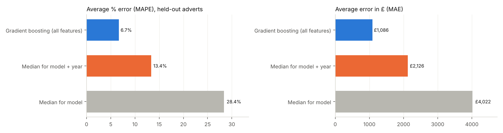
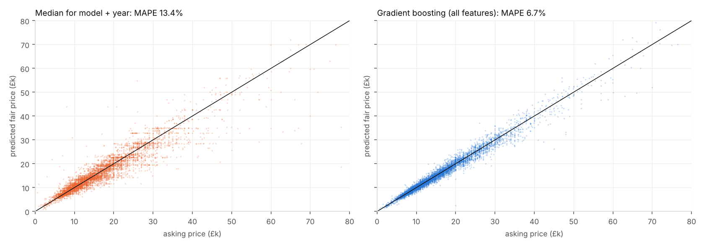
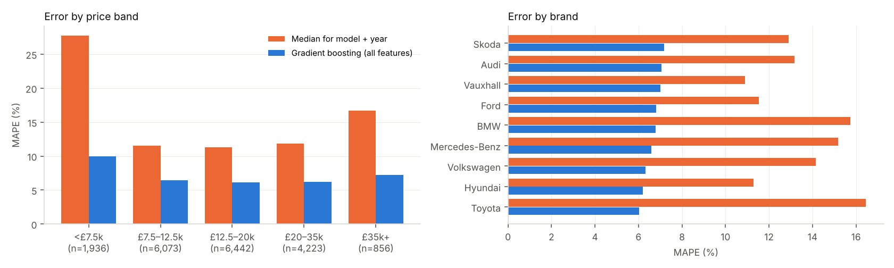
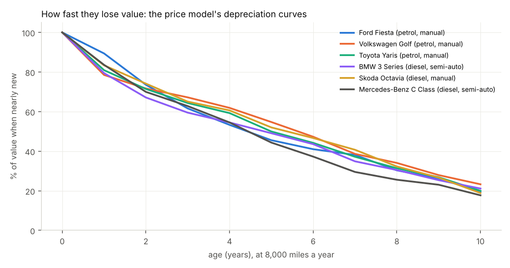

# 🚗 Car Matchmaker: Car recommendations that fit your needs and lifestyle

Describe your life in a sentence ("family of five in London with a dog, 40-mile commute, about £12k"). Car Matchmaker
turns that into requirements and gives you a ranked shortlist of used cars that fit, with the reasons each one was
picked and what you give up. It tells you whether an advert is a good price, and opens AutoTrader, eBay and Gumtree
already filtered to that car near your postcode, so you see real cars for sale today.

Built on **97,647 real UK used-car adverts** (Kaggle, 9 brands, 194 models) with a fair-price model that **halves the
error of the obvious baseline**.

| | Fair-price model | Median price for model + year | Median price for model |
|---|---|---|---|
| **MAPE** (average % error) | **6.7%** | 13.4% | 28.4% |
| MAE (average £ error) | **£1,086** | £2,126 | £4,022 |
| Within 10% of asking price | **79%** | 54% | 30% |
| R² | **0.967** | 0.833 | 0.599 |

Scored once on 19,530 held-out adverts the model never saw. The 80% "fair range" covers **80.0%** of them (it is
±11% wide).



## What it does

| | |
|---|---|
| 🗣️ **Understands your life** | "3 kids", "tow a caravan", "just passed", "London", "bad back", "40 mile commute", "under 50k miles"… become seats, body type, size, engine limits, ULEZ, yearly miles and budget. Every assumption is shown, and clashing needs ("first car" + "big dog") are flagged, not hidden. An optional LLM reader does the same with Claude. |
| 🎯 **Recommends and explains** | Ranks models on *your* priorities (running costs, value, space, performance, newer, availability, resale), one pick per model and at most two per brand. Each pick says why ("about £1,043 a year on fuel and tax at 11,700 miles") and what you give up ("smaller than the alternatives"). |
| 💷 **True cost of ownership** | Depreciation (from the price model) + fuel + road tax per year, over the years you'll keep it. Depreciation is usually the biggest cost, bigger than fuel and tax combined. |
| 🏷️ **Is this a good price?** | Enter an advert: fair value, fair range, a verdict from *Great price* to *Overpriced*, and the value over the next 6 years. |
| 📍 **Dealers near you** | One click opens AutoTrader, eBay and Gumtree searches pre-filtered to the model, budget, fuel, gearbox and your postcode: today's real stock. No scraping, just the URLs a buyer would type. |
| 🛒 **Live eBay listings** *(optional key)* | Today's listings from eBay's official Browse API, each priced against the model (year and mileage read from the title, "67 reg" included). |
| 🔍 **Check a number plate** *(optional keys)* | DVLA (tax, MOT, Euro standard → ULEZ) and the DVSA MOT history: mileage at every test, failures, advisories, plus red flags for **mileage going down** (possible clocking), dangerous defects and advisories that were never fixed. |

## Example

> **"Family of five in London with a dog, 40 mile commute, about £12k, SE15 4QF"**
>
> Understood: budget £12,000 · at least 5 seats · medium or bigger with a boot for the dog · about 11,700 miles a year ·
> ULEZ-compliant (London) · near SE15 4QF
>
> 1. **Volkswagen Golf SV (diesel)**, about £9,900, £1,970 a year to own: about £1,043 a year on fuel and tax (72 mpg listed), 5-seat medium MPV, loses about 28% in 3 years
> 2. **Toyota Verso (diesel)**: 7 seats, 78% of matching adverts priced under fair value
> 3. **Ford Grand C-MAX (diesel)**: 7 seats, 108 adverts to choose from
> 4. **Ford Kuga (diesel)** · 5. **Hyundai Tucson (diesel)**
>
> Each comes with links like `autotrader.co.uk/car-search?make=Volkswagen&model=Golf+SV&postcode=SE154QF&radius=50&price-to=12000&year-from=2016&fuel-type=Diesel`
> (2016 on, because diesels need Euro 6 for ULEZ).

When nothing fits, it says what to loosen. For a retired buyer wanting a hybrid SUV or MPV for £10k: *"No adverts in the data meet every requirement. Options: drop the fuel
requirement (53 models); drop the body requirement (3 models)."*

## Quick start

```bash
pip install -r requirements.txt
# download the Kaggle zip into data/raw/ (see data/README.md)
export PYTHONPATH=src               # Windows PowerShell: $env:PYTHONPATH="src"
python -m carmatch.price_model     # train + evaluate (≈15 s): reports/metrics.json, models/price_model.pkl
python -m carmatch.report          # README figures
streamlit run app.py
pytest -q                          # 21 tests, no network or data needed
```

The app trains the model itself on first run if `models/price_model.pkl` is missing.

### Optional keys (all free, entered in the app's sidebar or as environment variables)

| Feature | Variables | Where |
|---|---|---|
| AI reader for the sentence box | `ANTHROPIC_API_KEY` (+ `pip install anthropic`) | console.anthropic.com |
| Live eBay listings | `EBAY_CLIENT_ID`, `EBAY_CLIENT_SECRET` (Production keyset) | developer.ebay.com |
| DVLA vehicle check | `DVLA_API_KEY` | DVLA Vehicle Enquiry Service developer portal |
| MOT history | `MOT_CLIENT_ID`, `MOT_CLIENT_SECRET`, `MOT_API_KEY`, `MOT_TENANT_ID` | documentation.history.mot.api.gov.uk |

## How it works

```
"family of five in London…"  ──►  needs.py      requirements + reasons (rules, or an LLM with the same schema)
                                     │
97,647 adverts + catalogue  ──►  recommend.py   1 hard filters (budget, seats, body, size, fuel, gearbox, age, miles, engine, ULEZ)
                                     │           2 per advert: fair price, resale after N years, fuel + tax  ◄── price_model.py, costs.py
                                     │           3 group by model + fuel, score on priorities (percentile ranks), diversify
                                     ▼           4 reasons + trade-offs
                                 links.py       AutoTrader / eBay / Gumtree searches near the postcode
                                 live.py        eBay Browse API · DVLA · DVSA MOT history (optional)
```

**Fair-price model.** Histogram gradient boosting on log(price) from model, brand, age, mileage, engine size, fuel,
gearbox, mpg and tax (native categorical handling, no one-hot). Frozen split: 70% train, 10% calibration, 20% test.
The fair range is split-conformal: the 80th percentile of absolute log residuals on the calibration set.



**Where it's weaker.** Cars under £7,500 (MAPE 10.0%) and cars from 2010 or earlier (MAPE 25%, though only 257 test adverts), where condition and history matter more than
age and mileage. The largest misses are adverts with odd values (a 2008 Mondeo with 1 mile on the clock).



**Depreciation** from the model (typical spec, 8,000 miles a year): after 3 years a Golf keeps about 67% of its value, a
3 Series about 60%; after 6 years the C Class keeps the least (about 37%).



## Honest limits

* **2020 adverts.** Prices are 2020 asking prices. A price-level slider rescales them, and verdicts use the ratio to
  fair value, which carries over better than pounds. Dealer links always show today's market.
* **No electric cars** in the data (3 "Electric" rows, which look mislabelled, were removed). Asking for an EV gets hybrids plus a clear note.
* **Body, seats and size** come from a hand-built catalogue of each model's main version (99.35% of adverts covered).
  Two labels in the data mix different cars (Mercedes "CL Class" and "GL Class") and are never recommended.
* **Not modelled:** insurance, servicing, reliability, trim and condition. The number-plate check covers part of that.
* **Random split.** Exact duplicates are removed; near-duplicate adverts may remain, so the test score may be slightly optimistic.
* **Fuel prices** in `config/costs.yaml` are editable placeholders, not live data.
* **Link filters.** AutoTrader's make/model/postcode parameters match published example URLs; its other filter names,
  and Gumtree's price/distance filters, weren't checked against the live sites. They live in `config/dealers.yaml` so
  they're easy to fix.

## Project layout

```
app.py                     Streamlit app (6 tabs)
src/carmatch/
  data.py                  load the Kaggle zip, clean, log what was removed
  catalogue.py             body / seats / size for 190+ models, ambiguous labels
  needs.py                 Needs profile, sentence parser, optional LLM parser
  price_model.py           fair-price model, baselines, conformal range, evaluation
  costs.py                 fuel, tax, ULEZ, depreciation, cost of ownership
  recommend.py             filter → score → explain → diversify; "what to relax" suggestions
  links.py                 marketplace deep links (templates in config/dealers.yaml)
  live.py                  eBay Browse API, DVLA, DVSA MOT history, MOT red flags
  report.py                README figures
config/costs.yaml, dealers.yaml
notebooks/walkthrough.ipynb   EDA → model → calibration → importance → depreciation → recommendations
docs/methods.md, docs/model_card.md
tests/                     21 tests on synthetic data in the Kaggle schema and recorded API formats (no network)
```

## Tech

Python · pandas · scikit-learn (HistGradientBoosting, conformal prediction, permutation importance) · Streamlit ·
REST APIs (eBay OAuth client-credentials, DVLA, DVSA via Microsoft Entra) · optional Claude LLM · pytest · GitHub Actions

Data: [Kaggle: 100,000 UK Used Car Data set](https://www.kaggle.com/datasets/adityadesai13/used-car-dataset-ford-and-mercedes)
